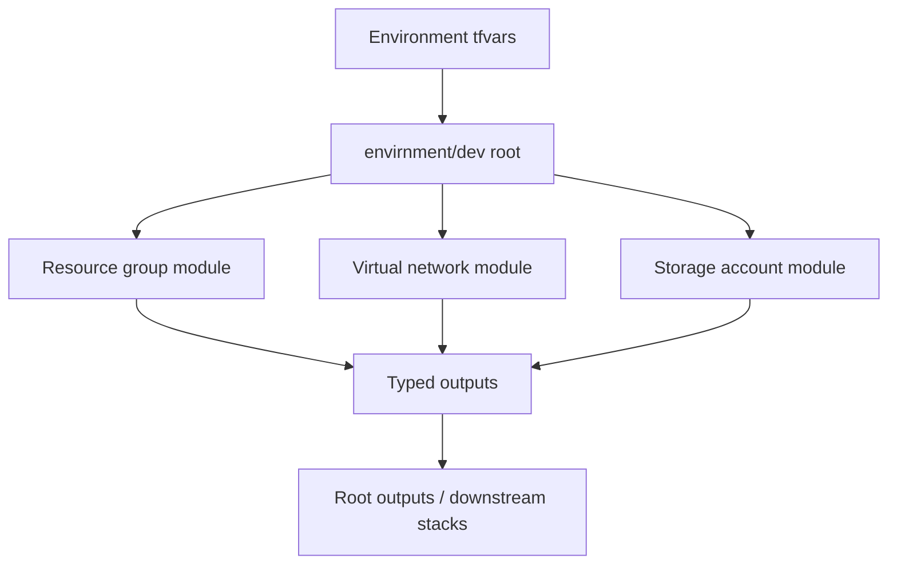

<div align="center">


### Typed contracts · Composable modules · Predictable outputs

[](https://developer.hashicorp.com/terraform)
[](https://azure.microsoft.com/)
[](https://developer.hashicorp.com/terraform/language/modules)

**A Terraform learning lab focused on module interface design: typed map/object inputs, `for_each` resource composition, stable outputs and environment-level orchestration.**

[Architecture](#-module-composition) · [Module contracts](#-module-contracts) · [Quick start](#-quick-start) · [Design notes](#-design-notes)

</div>

> [!NOTE]
> This is a learning/lab scaffold with CI validation. It is not represented as deployed Azure infrastructure. The historical `envirnment/` and child-module directory spellings are retained to avoid breaking existing references.

## Why reusable modules?

A reusable module should expose a predictable contract, hide repetitive resource details and make it easy for a root module to compose infrastructure for a specific environment. This repository demonstrates that pattern with resource groups, virtual networks and storage accounts.

## Module composition



## Module catalogue

| Module path | Responsibility | Interface pattern |
|---|---|---|
| `child/azurem_resource_group` | Create resource groups | Typed map/object input + `for_each` |
| `child/azurem_vnet` | Create virtual networks | Typed map/object input + `for_each` |
| `child/azurerm_storage_account` | Create StorageV2 accounts | Typed map/object input + `for_each` |
| `envirnment/dev` | Compose child modules | Environment variables and aggregated outputs |

Child modules expose maps of resource IDs and names; the root module composes and re-exports outputs so downstream code does not need to know every child resource address.

## Quick start

### Prerequisites

- Terraform CLI 1.6+.
- Azure CLI authenticated to a non-production subscription for cloud planning.
- Permissions to create the configured resource groups, VNets and storage accounts.

### Configure inputs

```bash
cp envirnment/dev/terraform.tfvars.example envirnment/dev/terraform.tfvars
```

Review every variable. Replace the example Storage account name with a globally unique 3–24 character lowercase alphanumeric name.

### Validate

```bash
terraform -chdir=envirnment/dev init
terraform -chdir=envirnment/dev fmt -check -recursive
terraform -chdir=envirnment/dev validate
terraform -chdir=envirnment/dev plan
```

Review the plan and estimated cost before any apply. The repository does not configure a shared remote-state backend; do not use local state as a team or production state solution.

## Design notes

- Typed inputs catch invalid caller shapes earlier than loosely typed variables.
- `for_each` with stable logical keys makes resource identity easier to reason about than positional indexing.
- Outputs should expose useful identifiers, not leak sensitive values.
- Secure storage defaults intentionally disable public network access and shared-key access. A consuming workload needs an approved private connectivity path and Microsoft Entra data-plane authorization.
- Remote state, locking, role assignments, private endpoints and private DNS are deployment-level concerns that must be designed for the target environment.

## CI and evidence

GitHub Actions runs formatting, backend-free initialization, validation and an advisory Checkov scan. CI does not create Azure resources. Review [Actions](../../actions) for the latest execution evidence.

## Repository layout

```text
child/
  azurem_resource_group/
  azurem_vnet/
  azurerm_storage_account/
envirnment/dev/
  main.tf
  variables.tf
  outputs.tf
  terraform.tfvars.example
.github/workflows/terraform-ci.yml
```

## Documentation

- [Architecture and interview guide](docs/README.md)
- [Zero-to-hero guide](docs/ZERO-TO-HERO.md)
- [Advanced module-design Q&A](docs/ADVANCED-INTERVIEW-BANK.md)

## Maintainer

**MD Amirul Haque** · [GitHub](https://github.com/haqueamir70-coder) · [LinkedIn](https://www.linkedin.com/in/md-amirul-haque/)

<sub>Good modules are products: stable contracts, clear outputs and safe defaults.</sub>
