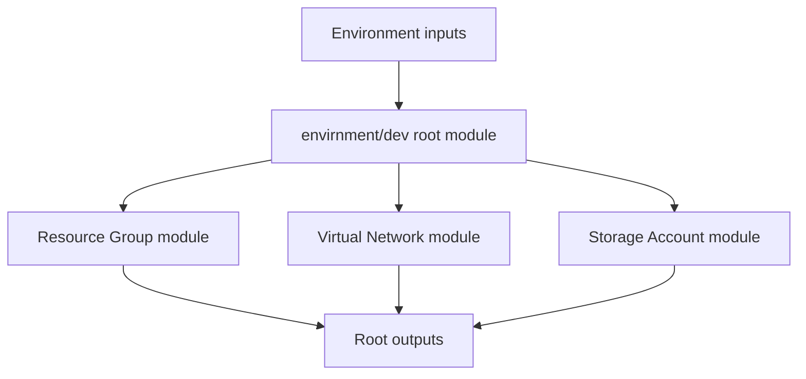

# Terraform Reusable Modules — Azure

> **Status:** Terraform learning project with typed module contracts, root composition, outputs, secure storage defaults, example inputs and GitHub Actions validation. This is a lab scaffold; no Azure deployment is claimed.

## Purpose

Demonstrate how a Terraform root module composes reusable Azure child modules using typed map/object inputs and exposes stable outputs for downstream stacks.

## Architecture



## Repository layout

- child/azurem_resource_group — resource group module
- child/azurem_vnet — virtual network module
- child/azurerm_storage_account — storage account module
- envirnment/dev — environment root module; historical directory spelling retained to avoid breaking references
- .github/workflows/terraform-ci.yml — formatting, validation and advisory Checkov scan

## Module contracts

All child modules use typed map(object(...)) inputs and for_each, so callers can create multiple resources using stable logical keys. Resource group, VNet and storage account modules expose maps of resource IDs and names; the root module aggregates resource names.

## Prerequisites

- Terraform CLI 1.6+
- Azure CLI authenticated to a non-production test subscription
- Azure permissions to create resource groups, VNets and storage accounts

## Configure and validate

From the repository root:

```bash
cp envirnment/dev/terraform.tfvars.example envirnment/dev/terraform.tfvars
terraform -chdir=envirnment/dev init
terraform -chdir=envirnment/dev fmt -check -recursive
terraform -chdir=envirnment/dev validate
terraform -chdir=envirnment/dev plan
```

Edit the example storage account name before planning. Azure Storage account names are globally unique and must contain 3–24 lowercase letters and numbers. Ensure every resource uses the intended resource group and region.

Review the complete plan and estimated cost before applying. This repository does not configure a remote state backend; do not use this root as a shared or production state store.

## Security notes

- Storage accounts default to HTTPS-only, TLS 1.2, shared-key access disabled and public network access disabled.
- These storage settings require a private endpoint/VNet path or another approved private connectivity design before workloads can access the account. The module does not silently expose storage publicly.
- Use remote state with access controls, encryption, versioning and locking before team use.
- Never commit terraform.tfstate files, plan files, credentials or real terraform.tfvars.
- The misspelled historical directory names are retained for compatibility; a future breaking cleanup should rename them consistently.

## CI

GitHub Actions checks formatting, initializes the environment without a remote backend, validates the composed configuration and runs an advisory Checkov scan. Triage Checkov findings before treating the baseline as a blocking security gate. CI does not deploy Azure resources.

## Author

MD Amirul Haque · [GitHub profile](https://github.com/haqueamir70-coder) · [LinkedIn](https://www.linkedin.com/in/md-amirul-haque/)
