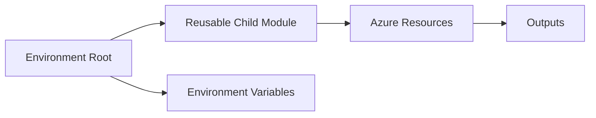

<div align="center">


[](https://developer.hashicorp.com/terraform)
[](https://azure.microsoft.com/)
[](https://github.com/haqueamir70-coder)

</div>

> **Portfolio project:** implementation status and limitations are documented below. The diagram describes the intended workflow/architecture and is not proof of a successful production deployment.

## 🗺️ Architecture at a Glance



---

# Terraform Module and Environment Practice

A small Terraform practice repository for exploring child modules and environment-specific configuration.

## Current layout

- `child/` — child-module directory
- `envirnment/` — environment configuration directory (the directory name is preserved as it exists in the repository)

Review the files in these directories to identify the exact resources and module inputs currently configured.

## Suggested workflow

From the relevant Terraform root module:

```bash
terraform fmt -check -recursive
terraform init
terraform validate
terraform plan
```

Review the plan before applying anything to an Azure subscription. Use a test environment first.

## Good next improvements

- Rename misspelled paths only after updating every reference and documenting the change.
- Add a root README with architecture, prerequisites, and example commands.
- Add explicit module inputs and outputs, variable validation, and examples.
- Add a `.gitignore` that excludes local state, variable files, and generated Terraform directories.
- Add CI checks for formatting and validation.

Never commit credentials, state files, or sensitive `terraform.tfvars` values.

## Author

MD Amirul Haque · [GitHub profile](https://github.com/haqueamir70-coder) · [LinkedIn](https://www.linkedin.com/in/md-amirul-haque/)
