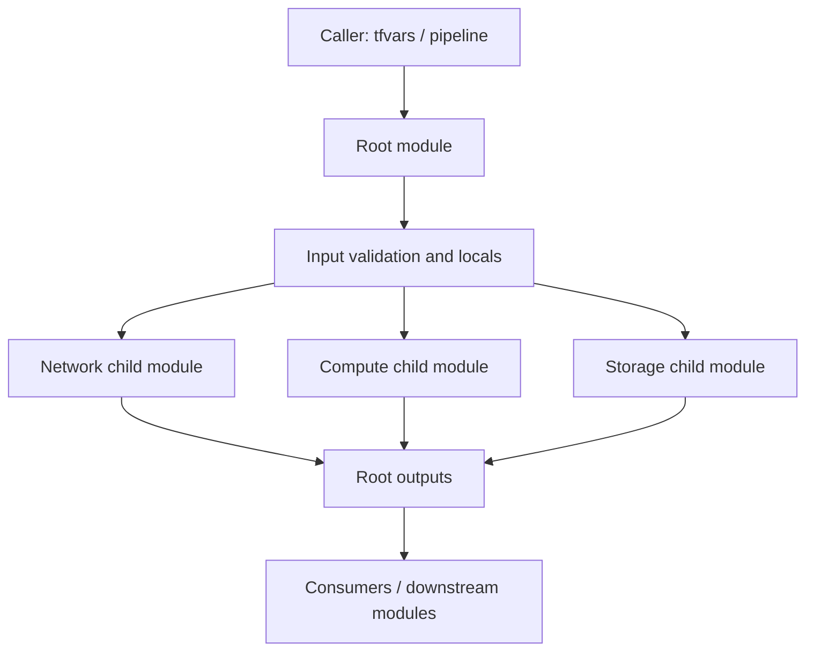

# Reusable Terraform module composition — Architecture & Interview Guide

A learning example showing typed inputs flowing through root and child modules. The architecture is conceptual; compare it with the actual module paths and variable names.

## Architecture diagram

## Interview questions

1. 1. What is a Terraform root module?
2. 2. How do child modules receive input variables?
3. 3. Why use object and map types instead of loosely typed variables?
4. 4. How do module outputs expose resource attributes?
5. 5. How do you pin provider versions and module versions?
6. 6. When should you use for_each in a module?
7. 7. How do you validate optional object attributes?
8. 8. How would you test a reusable module without deploying cloud resources?
9. 9. What makes a module interface backward-compatible?
10. 10. How would you publish and version this module for multiple teams?

## Interview preparation note
For each answer, cover the design rationale, trust boundary, failure mode, operational telemetry and validation method. Distinguish implemented, CI-validated, cloud-deployed and planned capabilities.

## Interview questions — suggested answers

### 1. Answer

A root module is the configuration a user runs; child modules encapsulate reusable resource patterns and are called by the root.

### 2. Answer

The root passes values into child module arguments, which map to declared input variables. Typed inputs define a clear interface and reject malformed values early.

### 3. Answer

Object/map types describe expected structure and allow validation; any weakens static guarantees and pushes errors to runtime.

### 4. Answer

Outputs expose selected resource attributes to the parent or caller, allowing module composition without referencing child internals.

### 5. Answer

Pin provider source/version constraints in required_providers and commit the dependency lock file. Pin remote modules to a release tag or immutable ref.

### 6. Answer

Use for_each when resources have meaningful stable keys or different configurations; it avoids index shifts associated with count.

### 7. Answer

Use optional attributes with defaults when supported, validate allowed values and ranges, and avoid ambiguous null handling.

### 8. Answer

Run fmt, init -backend=false, validate, TFLint, static security scans and module unit tests with mocked/fixture data where possible.

### 9. Answer

Keep variable names, types, defaults and output semantics stable. Introduce deprecation warnings and migration notes before removing inputs or outputs.

### 10. Answer

Publish a versioned module with README examples, compatibility matrix, tests, changelog and tagged releases. Consumers should pin versions rather than track main.

## Complete zero-to-hero guide

See [ZERO-TO-HERO.md](./ZERO-TO-HERO.md) for the business scenario, architecture walkthrough, tool-by-tool explanations, implementation sequence, practical commands, troubleshooting playbook and additional scenario-based interview questions with answers.
