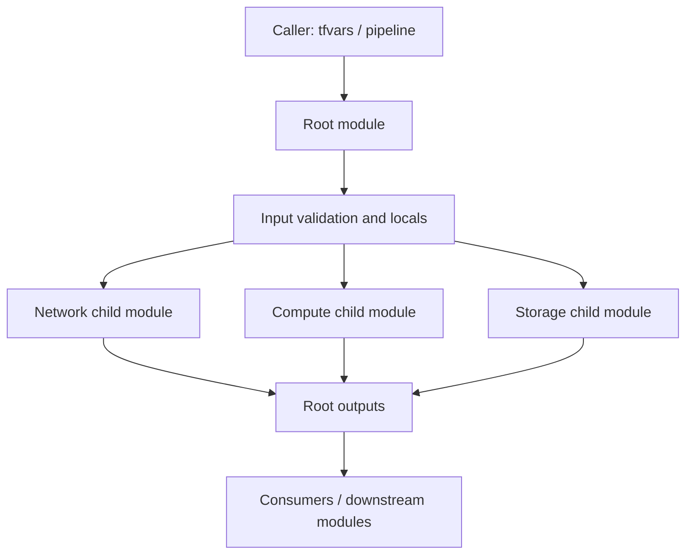

# Reusable Terraform module composition — Architecture & Interview Guide

A learning example showing typed inputs flowing through root and child modules. The architecture is conceptual; compare it with the actual module paths and variable names.

## Architecture diagram

## Interview questions

1. 1. What is a Terraform root module?
2. 2. How do child modules receive input variables?
3. 3. Why use object and map types instead of loosely typed variables?
4. 4. How do module outputs expose resource attributes?
5. 5. How do you pin provider versions and module versions?
6. 6. When should you use for_each in a module?
7. 7. How do you validate optional object attributes?
8. 8. How would you test a reusable module without deploying cloud resources?
9. 9. What makes a module interface backward-compatible?
10. 10. How would you publish and version this module for multiple teams?

## Interview preparation note
For each answer, cover the design rationale, trust boundary, failure mode, operational telemetry and validation method. Distinguish implemented, CI-validated, cloud-deployed and planned capabilities.
